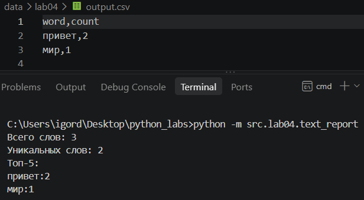
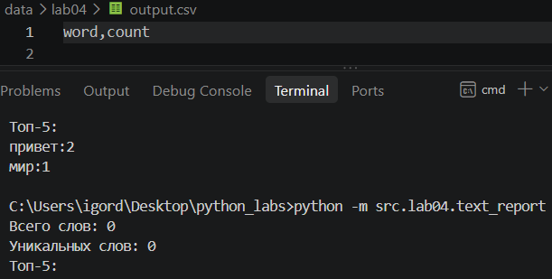
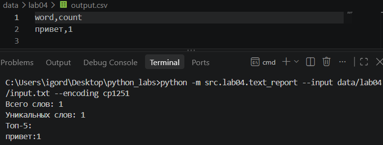

## ЛР4 — Файлы: TXT/CSV и отчёты по текстовой статистике

### Задание A

Код lab04/io_txt_csv.py:
```python
import csv
from pathlib import Path

def read_text(path: str | Path, encoding: str = "utf-8") -> str:
    """Открывает файл на чтение в указанной кодировке и возвращает содержимое как одну строку. Пример выбора другой кодировки (по умолчанию utf-8): read_text("text.txt", encoding="cp1251").
    Неверный тип любого из аргументов — TypeError."""
    if type(path) != str and type(path) != Path or type(encoding) != str:
        raise TypeError
    p = Path(path)
    return p.read_text(encoding=encoding)

def write_csv(rows: list[tuple | list], path: str | Path, header: tuple[str, ...] | None = None) -> None:
    """Создаёт/перезаписывает CSV с разделителем «,» (без кавычек).
    Если передан header, записывает его первой строкой.
    Неверный тип любого из аргументов — TypeError. Строки в rows неодинаковой длины — ValueError."""
    if type(rows) != list or type(path) != str and type(path) != Path or type(header) != tuple and header is not None:
        raise TypeError
    p = Path(path)
    rows = list(rows)
    if any(len(x) != len(rows[0]) for x in rows):
        raise ValueError
    with p.open("w", newline="", encoding="utf-8") as f:
        w = csv.writer(f)
        if header is not None:
            w.writerow(header)
        for r in rows:
            w.writerow(r)
```

### Задание B

Код lab04/text_report.py:
```python
from collections import Counter
from src.lab04.io_txt_csv import read_text, write_csv
from src.lib.text import normalize, tokenize
import argparse

def frequencies_from_text(text: str) -> Counter[str, int]:
    """Нормализует строку, разбивает на «слова», подсчитывает частоты и возвращает словарь (слово, количество).
    Неверный тип text — TypeError."""
    if type(text) != str:
        raise TypeError
    tokens = tokenize(normalize(text))
    print(f'Всего слов: {len(tokens)}')
    print(f'Уникальных слов: {len(set(tokens))}')
    return Counter(tokens)

def sorted_word_counts(freq: Counter[str, int]) -> list[tuple[str, int]]:
    """Возвращает топ по убыванию частоты; при равенстве — по алфавиту слова.
    Неверный тип freq — TypeError."""
    if type(freq) != Counter:
        raise TypeError
    top = sorted(freq.items(), key=lambda kv: (-kv[1], kv[0]))
    print(f'Топ-5:')
    for x, y in top[:5]:
        print(f'{x}:{y}')
    return top

parser = argparse.ArgumentParser()
parser.add_argument('--input', type=str, default='data/lab04/input.txt', help='Input file path')
parser.add_argument('--encoding', type=str, default='utf-8', help='Input file encoding')
args = parser.parse_args()

text = read_text(args.input, args.encoding)
top = sorted_word_counts(frequencies_from_text(text))

write_csv(top, path='data/lab04/output.csv', header=('word', 'count'))
```

Примеры запуска программы:
1) Без параметров командной строки:
```cmd
python -m src.lab04.text_report
```
2) С параметрами командной строки ("--input" — путь к файлу с входными данными, "--encoding" — кодировка файла с входными данными)
```cmd
python -m src.lab04.text_report --input data/lab04/input.txt --encoding cp1251
```

Запуск с обычными входными данными:


Запуск с пустыми входными данными:


Запуск с входными данными в кодировке cp1251:
