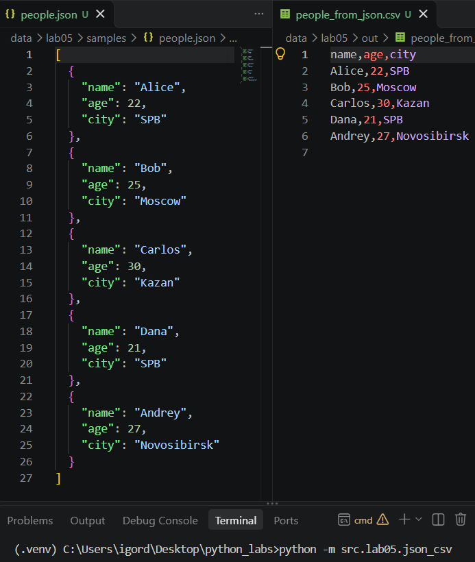
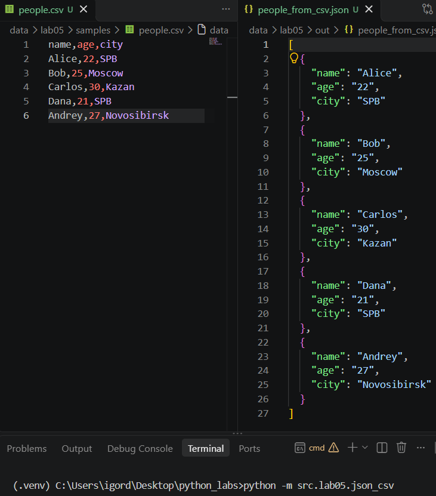
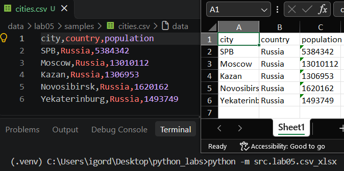

## ЛР5 — JSON и конвертации (JSON↔CSV, CSV→XLSX)

### Задание A

Код lab05/json_csv.py:
```python
import csv
import json

def json_to_csv(json_path: str, csv_path: str) -> None:
    """Преобразует JSON-файл в CSV. Поддерживает список словарей [{...}, {...}], заполняет отсутствующие поля пустыми строками. Кодировка UTF-8. Порядок колонок — как в первом объекте.
    Неверный тип любого из аргументов/пустой файл — ValueError. Отсутствует файл — FileNotFoundError."""
    if type(json_path) != str or type(csv_path) != str:
        raise TypeError
    if not json_path.endswith('.json') or not csv_path.endswith('.csv'):
        raise ValueError
    with open(json_path, 'r', encoding='utf-8') as json_file:
        rows = json.load(json_file)
    if type(rows) != list:
        raise TypeError
    if len(rows) == 0:
        raise ValueError('Пустой JSON или неподдерживаемая структура.')
    if any(type(row) != dict for row in rows):
        raise ValueError
    with open(csv_path, 'w', encoding='utf-8', newline='') as csv_file:
        w = csv.DictWriter(csv_file, fieldnames=[key for key in rows[0].keys()])
        w.writeheader()
        w.writerows(rows)

def csv_to_json(csv_path: str, json_path: str) -> None:
    """Преобразует CSV в JSON (список словарей). Заголовок обязателен, значения сохраняются как строки.
    Неверный тип любого из аргументов/пустой файл — ValueError. Отсутствует файл — FileNotFoundError."""
    if type(csv_path) != str or type(json_path) != str:
        raise TypeError
    if not csv_path.endswith('.csv') or not json_path.endswith('.json'):
        raise ValueError
    with open(csv_path, 'r', encoding='utf-8', newline='') as csv_file:
        sample = csv_file.read(2048)
        csv_file.seek(0)
        if not csv.Sniffer().has_header(sample):
            raise ValueError
        rows = list(csv.DictReader(csv_file))
    if len(rows) == 0:
        raise ValueError
    with open(json_path, 'w', encoding='utf-8') as json_file:
        json.dump(rows, json_file, ensure_ascii=False, indent=2)

if __name__ == '__main__':
    json_to_csv('data/lab05/samples/people.json', 'data/lab05/out/people_from_json.csv')
    csv_to_json('data/lab05/samples/people.csv', 'data/lab05/out/people_from_csv.json')
```

Тест json_csv:


Тест csv_json:


### Задание B

Код lab05/csv_xlsx.py:
```python
import csv
import openpyxl

def csv_to_xlsx(csv_path: str, xlsx_path: str) -> None:
    """Конвертирует CSV в XLSX. Первая строка CSV — заголовок. Лист называется «Sheet1». Колонки — автоширина по длине текста (не менее 8 символов).
    Неверный тип любого из аргументов — TypeError. Неверный тип любого из файлов/пустой файл — ValueError. Отсутствует файл — FileNotFoundError."""
    if type(csv_path) != str or type(xlsx_path) != str:
        raise TypeError
    if not csv_path.endswith('.csv') or not xlsx_path.endswith('.xlsx'):
        raise ValueError
    with open(csv_path, 'r', encoding='utf-8') as csv_file:
        sample = csv_file.read(2048)
        csv_file.seek(0)
        if not csv.Sniffer().has_header(sample):
            raise ValueError
        rows = list(csv.reader(csv_file))
        if len(rows) < 2:
            raise ValueError
        wb = openpyxl.Workbook()
        ws = wb.active
        ws.title = 'Sheet1'
        for row in rows:
            ws.append(row)
        wb.save(xlsx_path)

if __name__ == '__main__':
    csv_to_xlsx('data/lab05/samples/cities.csv', 'data/lab05/out/xlsx_from_csv.xlsx')
```

Тест csv_xlsx:
