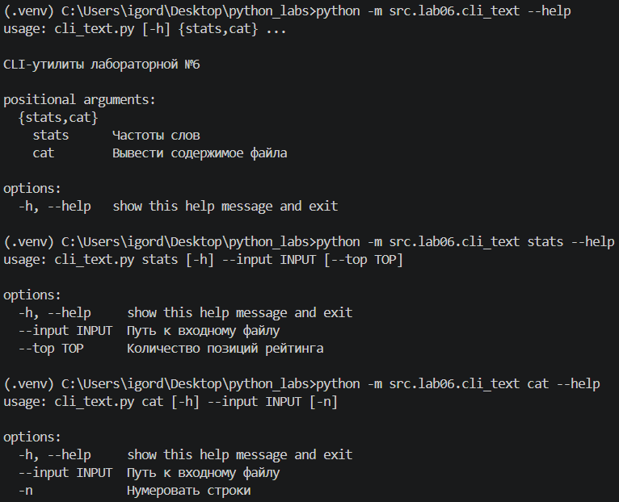
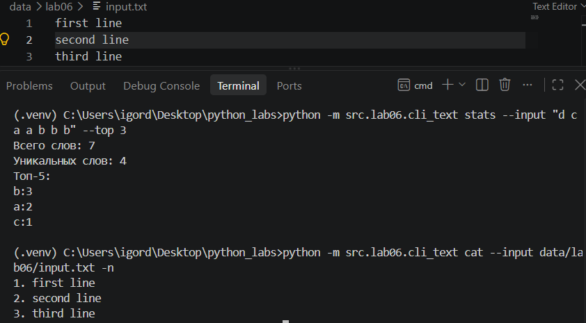
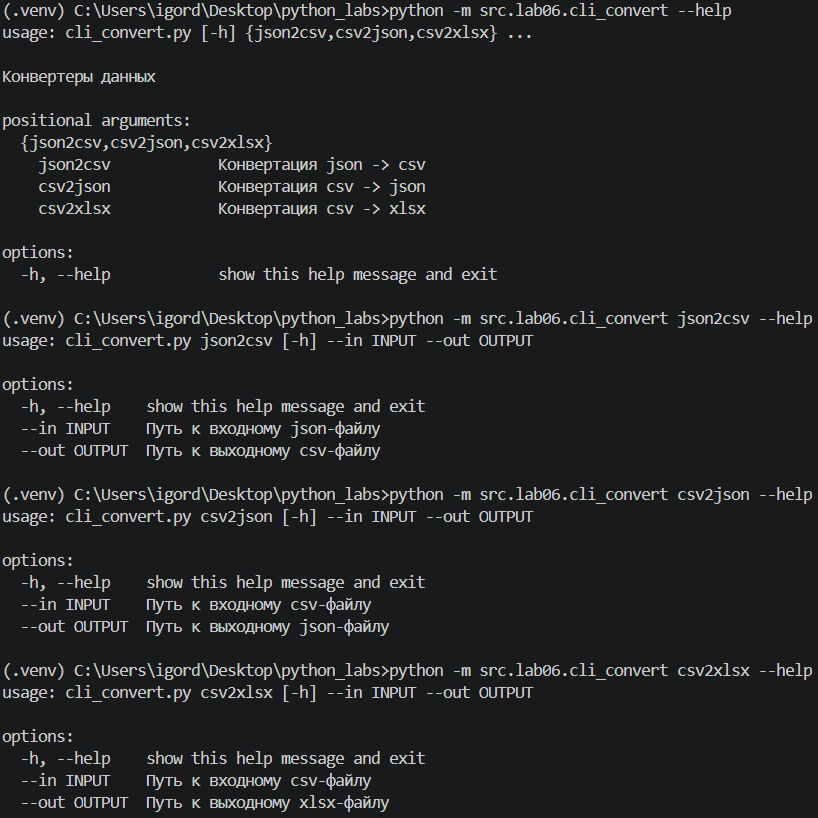
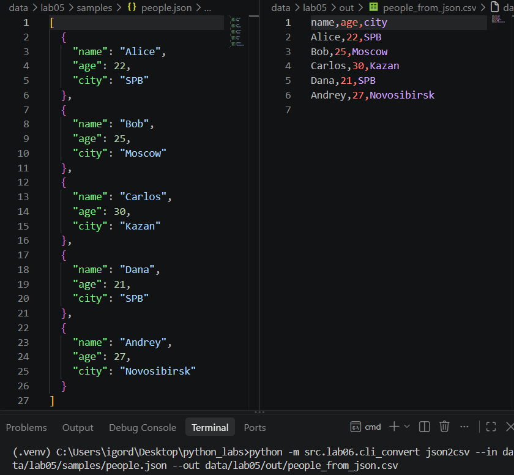
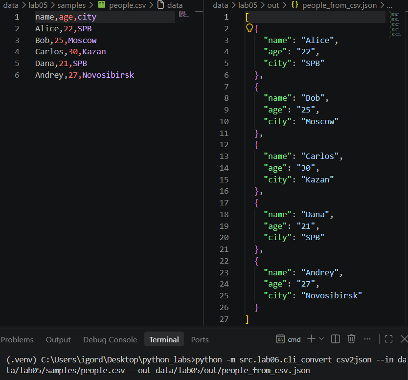
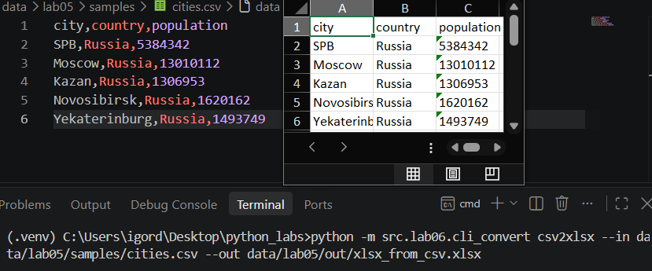

## ЛР6 — CLI‑утилиты с argparse (cat/grep‑lite + конвертеры): Техническое задание

### Задание 1

Код lab05/cli_text.py:
```python
'''Модуль с подкомандами:
1) stats --input <txt> [--top 5] — анализ частот слов в тексте
2) cat --input <path> [-n] — вывод содержимого файла построчно (с нумерацией при -n)'''

import argparse
from src.lib.text import normalize, tokenize, count_freq, top_n

def main():
    parser = argparse.ArgumentParser(description="CLI‑утилиты лабораторной №6")
    subparsers = parser.add_subparsers(dest="command")

    # подкоманда stats
    stats_parser = subparsers.add_parser("stats", help="Частоты слов")
    stats_parser.add_argument("--input", required=True, help="Путь к входному файлу")
    stats_parser.add_argument("--top", type=int, default=5, help="Количество позиций рейтинга")

    # подкоманда cat
    cat_parser = subparsers.add_parser("cat", help="Вывести содержимое файла")
    cat_parser.add_argument("--input", required=True, help="Путь к входному файлу")
    cat_parser.add_argument("-n", action="store_true", help="Нумеровать строки")

    args = parser.parse_args()

    if args.command == "stats":
        tokens = tokenize(normalize(args.input))
        print(f'Всего слов: {len(tokens)}')
        unique_tokens = set(tokens)
        print(f'Уникальных слов: {len(unique_tokens)}')
        top = top_n(count_freq(tokens), args.top)
        print(f'Топ-5:')
        for x, y in top:
            print(f'{x}:{y}')
    elif args.command == "cat":
        with open(args.input, 'r', encoding='utf-8') as f:
            lines = f.readlines()
            if args.n:
                for i, line in enumerate(lines, start=1):
                    print(f'{i}. {line}', end='')
            else:
                for line in lines:
                    print(line)

if __name__ == "__main__":
    main()
```

Справка по cli_text.py:


Тест cli_text.py:


### Задание 2

Код lab05/cli_convert.py:
```python
'''Модуль src/lab06/cli_convert.py с подкомандами:
1) json2csv --in <path> --out <path> — json → csv
2) csv2json --in <path> --out <path> — csv → json
3) csv2xlsx --in <path> --out <path> — csv → xlsx'''

import argparse
from src.lab05.json_csv import json_to_csv, csv_to_json
from src.lab05.csv_xlsx import csv_to_xlsx

def main():
    parser = argparse.ArgumentParser(description="Конвертеры данных")
    sub = parser.add_subparsers(dest="cmd")

    p1 = sub.add_parser("json2csv", help="Конвертация json -> csv")
    p1.add_argument("--in", dest="input", required=True, help="Путь к входному json-файлу")
    p1.add_argument("--out", dest="output", required=True, help="Путь к выходному csv-файлу")

    p2 = sub.add_parser("csv2json", help="Конвертация csv -> json")
    p2.add_argument("--in", dest="input", required=True, help="Путь к входному csv-файлу")
    p2.add_argument("--out", dest="output", required=True, help="Путь к выходному json-файлу")

    p3 = sub.add_parser("csv2xlsx", help="Конвертация csv -> xlsx")
    p3.add_argument("--in", dest="input", required=True, help="Путь к входному csv-файлу")
    p3.add_argument("--out", dest="output", required=True, help="Путь к выходному xlsx-файлу")

    args = parser.parse_args()

    if args.cmd == 'json2csv':
        json_to_csv(args.input, args.output)
    elif args.cmd == 'csv2json':
        csv_to_json(args.input, args.output)
    elif args.cmd == 'csv2xlsx':
        csv_to_xlsx(args.input, args.output)

if __name__ == "__main__":
    main()
```

Справка по cli_convert.py:


Тест cli_convert.py:
1) json → csv:

2) csv → json:

3) csv → xlsx:
